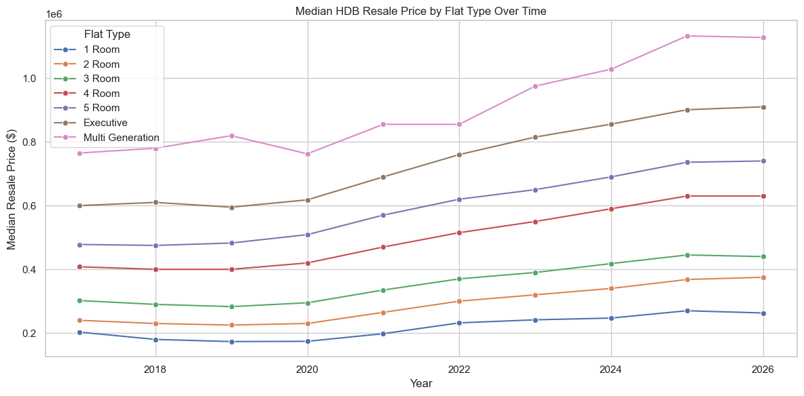
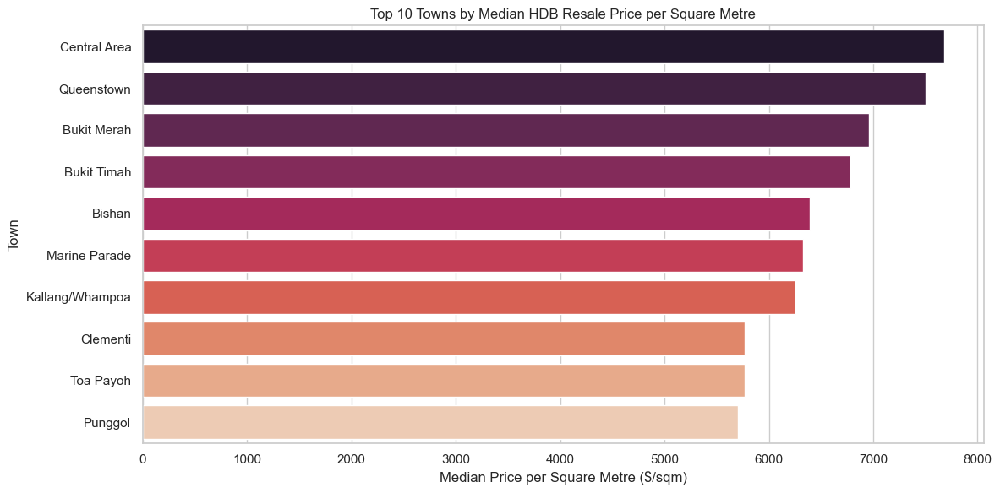
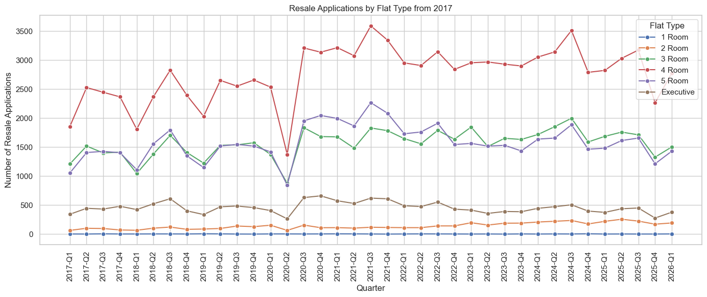
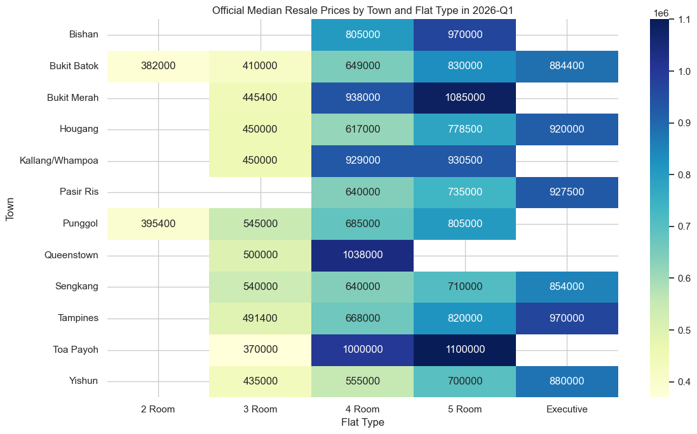

# HDB Resale Price Analysis

An analysis of HDB resale price pressure in Singapore, built in Python and Jupyter. I cleaned and merged four official datasets from data.gov.sg (over 236,000 resale transactions), created measures such as price per square metre, and analysed price, demand and supply trends with visualisations.

**Solo project · Jul – Aug 2026**

**Tools:** Python · pandas · NumPy · Matplotlib · Seaborn · Jupyter

👉 **[Open the full notebook](hdb_resale_price_analysis.ipynb)** (GitHub renders it with all code, outputs and charts)

---

## Research questions

1. Which HDB flat types experienced the strongest resale price growth?
2. Which towns have the highest resale prices and price per square metre?
3. How does resale demand differ across flat types, and does it move together with resale prices?
4. How does HDB flat supply differ across towns and flat types?

## Key findings

- **Prices rose for every flat type from 2017 to 2026.** 2 Room flats grew the most in percentage terms (+56%, $240,000 → $375,000), while Multi Generation flats grew the most in dollar terms (+$362,500).
- **Price per square metre tells a different story from total price.** Central Area leads at about $7,679/sqm, followed by Queenstown, Bukit Merah, Bukit Timah and Bishan. Bukit Timah has the highest median price but is not first once flat size is accounted for.
- **Demand and price move together for some flat types but not others.** 2 Room flats show a strong correlation between resale applications and median price (0.84); 3 and 4 Room are moderate (~0.45); Executive and 1 Room are negative.
- **Supply alone does not explain prices.** Towns with the most sold HDB units are not necessarily the cheapest, so location, estate maturity and remaining lease also matter.

## Selected charts

| Median resale price by flat type | Top 10 towns by price per sqm |
|---|---|
|  |  |
| **Resale applications by flat type** | **Official median prices by town and flat type** |
|  |  |

## What I did

- **Data cleaning:** converted date columns and text-based price values to proper types, checked flat-type labels across datasets, verified the results after cleaning, and kept the raw data unchanged by working on copies.
- **Feature engineering:** price per square metre, year and quarter columns for joining datasets.
- **Merging:** joined transaction-level prices with quarterly demand data on `quarter` and `flat_type`, and with 2021 supply data by town.
- **Analysis:** grouped summaries with `groupby` / `agg`, percentage and dollar growth, correlation between demand and price, and validation of my calculated medians against HDB's official median prices.
- **Visualisation:** line charts, bar charts, boxplots, scatter plots and a heatmap with Matplotlib and Seaborn.

## Datasets

All data is from [data.gov.sg](https://data.gov.sg) (source agency: HDB).

| Dataset | Used for |
|---|---|
| [Resale Flat Prices (Jan 2017 onwards)](https://data.gov.sg/datasets/d_8b84c4ee58e3cfc0ece0d773c8ca6abc/view) | Main transaction-level price data |
| [Number of Resale Applications Registered by Flat Type](https://data.gov.sg/datasets/d_02aa4bb51bc674f3a2d0b9bb6911d934/view) | Demand |
| [Median Resale Prices for Registered Applications by Town and Flat Type](https://data.gov.sg/datasets/d_b51323a474ba789fb4cc3db58a3116d4/view) | Validation against official figures |
| [Dwelling Units under HDB's Management by Town and Flat Type](https://data.gov.sg/datasets/d_07b1eeeb22efdf7faf5bd6a13667359d/view) | Supply |

## Run it yourself

```bash
git clone https://github.com/ThantEaindray/HDB-Resale-Price-Analysis.git
cd HDB-Resale-Price-Analysis
pip install -r requirements.txt
```

Download the four CSV files from the links above into a `Datasets/` folder next to the notebook, then open `hdb_resale_price_analysis.ipynb` in Jupyter and run all cells.

## Limitations

- The resale data covers completed transactions only, and 2026 is a partial year.
- Supply data only goes up to 2021, so it is used as background context.
- Correlation between demand and price does not prove causation; factors like MRT access, floor level and remaining lease were not modelled.

---

Built by **Thant Eaindray** as part of the module *EP0302 Programming for Data Science*.
